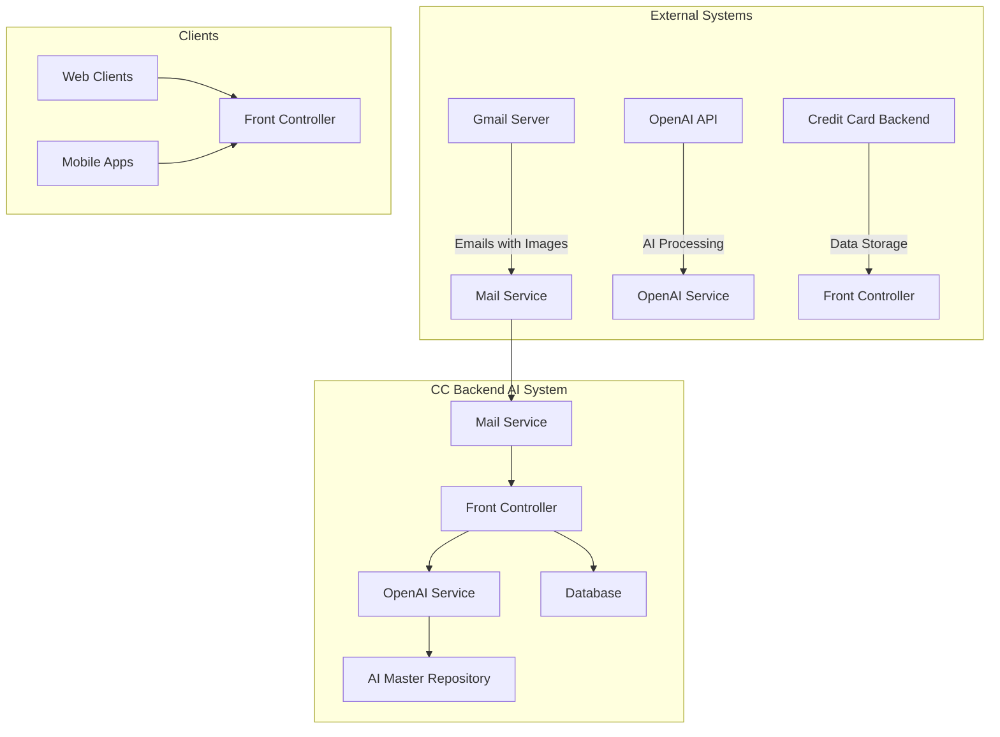
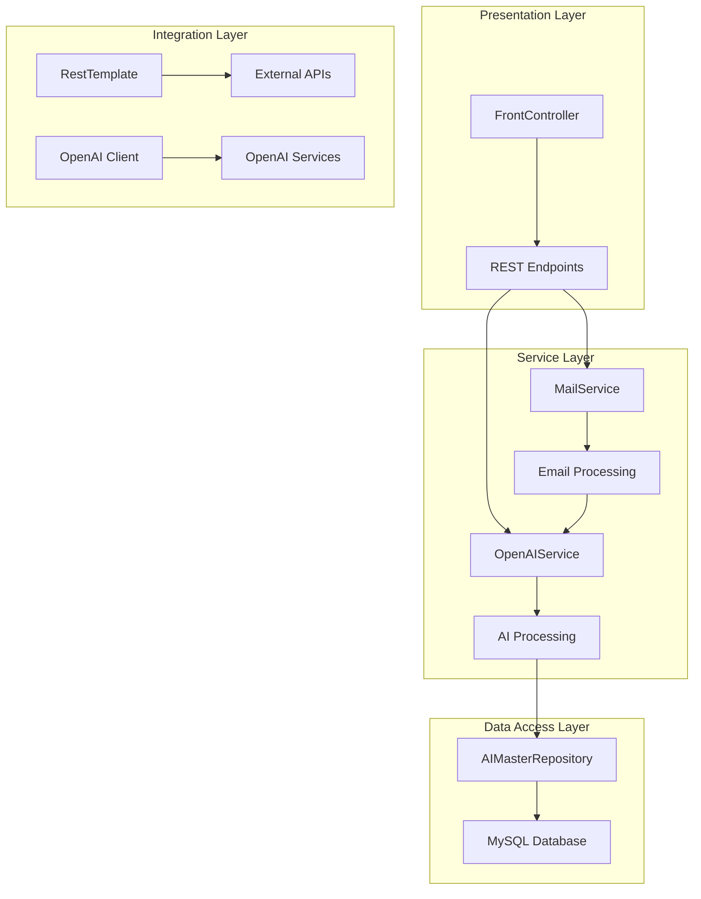
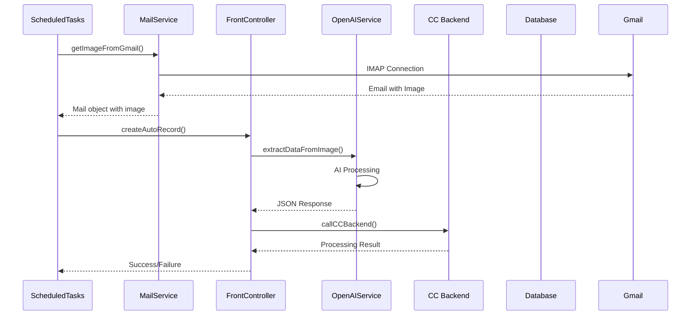
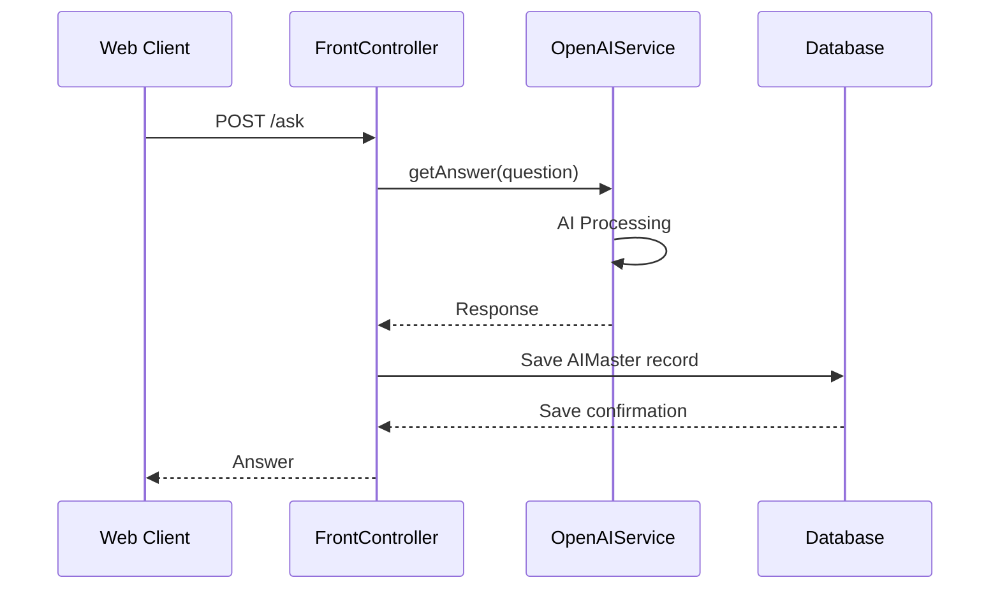
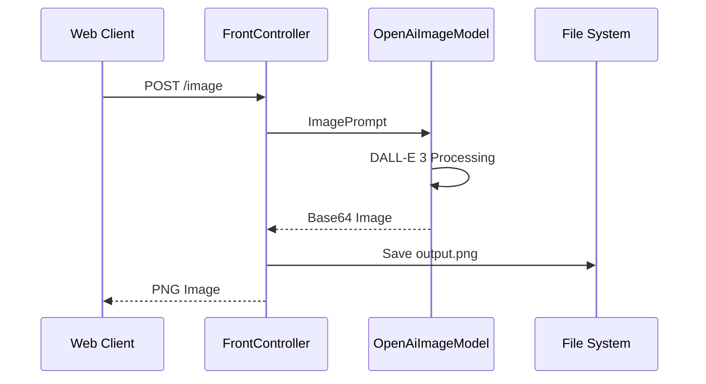

# Credit Card Backend AI System

## Table of Contents
1. [System Overview](#system-overview)
2. [Architecture](#architecture)
3. [Components](#components)
4. [Data Flow](#data-flow)
5. [API Specifications](#api-specifications)
6. [Database Schema](#database-schema)
7. [Configuration](#configuration)
8. [Deployment](#deployment)
9. [Security](#security)
10. [Monitoring & Logging](#monitoring--logging)

---

## System Overview

The Credit Card Backend AI System is a Spring Boot application that leverages AI capabilities to process credit card statements and extract structured data from images. The system integrates with external services including OpenAI for AI processing and a credit card backend system for data storage.

### Key Features
- **AI-Powered Image Processing**: Extracts structured data from credit card statement images
- **Scheduled Processing**: Automated processing of emails with statement images
- **REST API**: Provides endpoints for manual processing and health checks
- **Mail Integration**: Monitors Gmail for incoming statement images
- **Data Persistence**: Stores AI processing history and metadata

### System Context Diagram



---

## Architecture

### Technology Stack
- **Framework**: Spring Boot 3.4.4
- **Language**: Java 21
- **AI Framework**: Spring AI 1.0.0-M6
- **Database**: MySQL
- **Build Tool**: Maven
- **Image Processing**: OpenAI DALL-E 3
- **Mail Protocol**: IMAP (Gmail)

### Architectural Pattern
The system follows a **Layered Architecture** with the following layers:

1. **Presentation Layer**: REST controllers
2. **Service Layer**: Business logic and AI processing
3. **Data Access Layer**: JPA repositories
4. **Integration Layer**: External API clients

### Component Architecture Diagram



---

## Components

### 1. Application Entry Point
**File**: `CcBackendAiApplication.java`
- Main Spring Boot application class
- Enables scheduling with `@EnableScheduling`
- Sets default timezone to IST (GMT+05:30)

### 2. Controllers

#### FrontController
**File**: `controller/FrontController.java`
**Endpoints**:
- `POST /ask` - Manual AI question processing
- `POST /image` - Generate images using DALL-E 3
- `GET /auto` - Trigger automated processing
- `GET /health` - Health check endpoint

**Key Features**:
- Cross-origin support enabled
- Image generation with Base64 encoding
- Integration with external CC backend system

### 3. Services

#### OpenAIService
**File**: `service/OpenAIService.java`
**Responsibilities**:
- AI prompt processing and response generation
- Image data extraction using computer vision
- Performance monitoring and logging
- Data persistence for AI interactions

**Key Methods**:
- `getAnswer(Question)` - Process text prompts
- `extractDataFromImage(String, File)` - Extract data from statement images
- `getPromptsMailBody(List<String>)` - Generate email content

#### MailService
**File**: `service/MailService.java`
**Responsibilities**:
- Monitor Gmail for new emails
- Extract images from email attachments
- Filter emails by subject prefix ("CC-")
- Mark processed emails as read

**Key Features**:
- IMAP protocol integration
- File attachment processing
- Timezone-aware email filtering

### 4. Models

#### Question & Answer
**Files**: `model/Question.java`, `model/Answer.java`
- Simple record classes for API communication
- Immutable data structures

#### Mail
**File**: `model/Mail.java`
- Represents email data with subject and attachment
- Uses Lombok for boilerplate reduction

#### AIMaster
**File**: `model/AIMaster.java`
- JPA entity for storing AI processing history
- Tracks prompt, response, timing, and performance metrics

### 5. Repository

#### AIMasterRepository
**File**: `repository/AIMasterRepository.java`
- JPA repository interface
- Custom query for date-based filtering
- Extends `JpaRepository<AIMaster, Integer>`

### 6. Configuration

#### RestTemplateConfig
**File**: `RestTemplateConfig.java`
- Configures RestTemplate bean for HTTP requests
- Used for external API integration

#### ScheduledTasks
**File**: `ScheduledTasks.java`
- Automated task scheduler
- Runs at 11:00 AM and 11:00 PM IST daily
- Triggers automated email processing

---

## Data Flow

### 1. Automated Processing Flow



### 2. Manual Processing Flow



### 3. Image Generation Flow



---

## API Specifications

### REST Endpoints

#### 1. Manual AI Processing
```
POST /ask
Content-Type: application/json
Request Body: {"question": "Your question here"}
Response: {"answer": "AI response"}
```

#### 2. Image Generation
```
POST /image
Content-Type: application/json
Request Body: {"question": "Image description"}
Response: PNG image (binary)
```

#### 3. Automated Processing
```
GET /auto
Response: JSON from CC Backend or null
```

#### 4. Health Check
```
GET /health
Response: "CC Backend AI is up and running!"
```

### Request/Response Examples

#### AI Processing Request
```json
{
  "question": "What is the total amount due on this credit card statement?"
}
```

#### AI Processing Response
```json
{
  "answer": "The total amount due is $1,250.00"
}
```

#### Image Data Extraction Response
```json
{
  "key": {
    "code": "CC001",
    "stmtMonthYear": "032024"
  },
  "name": "John Doe",
  "minAmt": 50,
  "totalAmt": 1250,
  "stmtDate": "2024-03-01",
  "dueDate": "2024-03-25",
  "currentStatus": "Bill Generated",
  "month": "03",
  "year": "2024"
}
```

---

## Database Schema

### AIMaster Table

| Column Name | Data Type | Description |
|-------------|-----------|-------------|
| pId | INTEGER (PK) | Primary key, auto-generated |
| prompt | VARCHAR | Original AI prompt |
| answer | VARCHAR | AI response (max 1000 chars) |
| timeIn | VARCHAR | Processing start time |
| timeOut | VARCHAR | Processing end time |
| respTime | BIGINT | Response time in milliseconds |

### Entity Mapping
```java
@Entity(name = "AI_MASTER")
public class AIMaster {
    @Id
    @GeneratedValue(strategy = GenerationType.IDENTITY)
    private Integer pId;
    private String prompt;
    private String answer;
    private String timeIn;
    private String timeOut;
    private Long respTime;
}
```

---

## Configuration

### Application Properties
```properties
# Server Configuration
server.port = 2991
spring.application.name = cc-backend-ai

# Database Configuration
spring.jpa.hibernate.ddl-auto = none
spring.datasource.url = ${MYSQL_DB_URL}
spring.datasource.username = ${MYSQL_DB_USER}
spring.datasource.password = ${MYSQL_DB_PASS}
spring.datasource.driver-class-name = com.mysql.cj.jdbc.Driver

# Mail Configuration
spring.mail.store.protocol = imaps
spring.mail.imap.host = imap.gmail.com
spring.mail.imap.port = 993
spring.mail.username = ${MAIL_USER}
spring.mail.password = ${MAIL_PASS}

# AI Configuration
spring.ai.openai.api-key = ${OPENAI_API_KEY}

# Custom Configuration
codeNameMap = ${CODE_NAME_VALUES}
authHeaderBP = ${AUTH_HEADER_BP}
ccBackendURL = ${CC_BACKEND_URL}
```

### Environment Variables Required
- `MYSQL_DB_URL` - MySQL database connection URL
- `MYSQL_DB_USER` - Database username
- `MYSQL_DB_PASS` - Database password
- `MAIL_USER` - Gmail username
- `MAIL_PASS` - Gmail password
- `OPENAI_API_KEY` - OpenAI API key
- `CODE_NAME_VALUES` - Code to name mapping
- `AUTH_HEADER_BP` - Authorization header for CC backend
- `CC_BACKEND_URL` - CC backend API endpoint

---

## Deployment

### Docker Configuration
**File**: `Dockerfile`
```dockerfile
FROM eclipse-temurin:21-jdk
COPY target/cc-backend-ai-0.0.1-SNAPSHOT.jar cc-backend-ai.jar
EXPOSE 2991
ENTRYPOINT ["java","-jar","/cc-backend-ai.jar"]
```

### Build Instructions
```bash
# Build the application
./mvnw clean package

# Run locally
java -jar target/cc-backend-ai-0.0.1-SNAPSHOT.jar

# Build Docker image
docker build -t cc-backend-ai .
```

### Production Deployment
1. Set all required environment variables
2. Build the Docker image
3. Deploy to container orchestration platform
4. Configure health checks and monitoring
5. Set up log aggregation

---

## Security

### Authentication & Authorization
- **API Security**: Uses Bearer token authentication for CC backend integration
- **Mail Security**: IMAP over SSL/TLS for Gmail integration
- **Database Security**: Connection string with credentials from environment variables

### Data Protection
- **Sensitive Data**: Explicitly avoids storing credit card numbers
- **File Handling**: Temporary file storage with automatic cleanup
- **Logging**: Sensitive information filtering in logs

### Security Best Practices
- Environment variables for all secrets
- No hardcoded credentials
- Input validation and sanitization
- HTTPS for all external communications

---

## Monitoring & Logging

### Logging Configuration
- **Framework**: SLF4J with Lombok `@Slf4j`
- **Level**: TRACE for SQL queries, INFO for business operations
- **Output**: Console and file-based logging

### Key Log Messages
- AI processing start/end times
- Mail processing status
- Image extraction success/failure
- API call results
- Scheduled task execution

### Performance Monitoring
- **Response Time Tracking**: Built into AIMaster entity
- **Processing Metrics**: Start/end timestamps
- **Error Handling**: Comprehensive exception logging

### Health Monitoring
- **Health Endpoint**: `/health` returns system status
- **Scheduled Task Monitoring**: Logs task execution results
- **External Service Monitoring**: Tracks OpenAI and CC backend availability

---

## Error Handling

### Exception Handling Strategy
- **Graceful Degradation**: System continues operation on non-critical failures
- **Detailed Logging**: All exceptions logged with context
- **User-Friendly Messages**: Generic error responses to clients

### Common Error Scenarios
1. **Mail Connection Failure**: Logs error, continues operation
2. **OpenAI API Failure**: Logs error, returns null response
3. **Database Connection Failure**: Application fails to start
4. **Invalid Image Format**: Skips processing, logs warning

### Retry Mechanisms
- **Scheduled Tasks**: Automatic retry on next scheduled run
- **External API Calls**: No built-in retry (relies on external service reliability)

---

## Integration Points

### External Services

#### OpenAI Integration
- **Purpose**: AI processing and image generation
- **Models Used**: GPT for text processing, DALL-E 3 for image generation
- **Authentication**: API key from environment variables
- **Rate Limiting**: Handled by OpenAI service

#### Gmail Integration
- **Protocol**: IMAP over SSL
- **Authentication**: Username/password with app-specific password
- **Filtering**: Subject-based filtering for CC emails
- **Attachment Processing**: JPEG image extraction

#### CC Backend Integration
- **Purpose**: Data storage and further processing
- **Protocol**: REST API with JSON
- **Authentication**: Bearer token in Authorization header
- **Data Format**: Structured JSON with specific schema

---

## Performance Considerations

### Database Optimization
- **Connection Pooling**: HikariCP with optimized settings
- **Query Optimization**: Simple queries with appropriate indexing
- **Data Retention**: No automatic cleanup (may need scheduled cleanup)

### AI Processing Optimization
- **Response Capping**: Limits responses to 1000 characters
- **Performance Tracking**: Built-in timing measurement
- **Resource Management**: Temporary file handling

### Mail Processing Optimization
- **Time-based Filtering**: Only processes today's emails
- **Unread Filtering**: Skips already processed emails
- **Subject Filtering**: Only processes CC-prefixed emails

---

## Future Enhancements

### Potential Improvements
1. **Caching**: Implement Redis for AI response caching
2. **Batch Processing**: Process multiple emails in single run
3. **Error Recovery**: Implement retry mechanisms for failed operations
4. **Metrics Dashboard**: Add Prometheus/Grafana integration
5. **File Cleanup**: Automatic cleanup of temporary files
6. **Data Validation**: Enhanced validation of extracted data

### Scalability Considerations
1. **Horizontal Scaling**: Stateless design allows easy scaling
2. **Database Scaling**: Consider read replicas for high volume
3. **AI Processing**: Consider async processing for high throughput
4. **Mail Processing**: Consider IMAP IDLE for real-time processing

---

## Conclusion

The Credit Card Backend AI System is a well-architected Spring Boot application that effectively integrates AI capabilities with traditional enterprise systems. The system demonstrates best practices in:

- **Modular Design**: Clear separation of concerns
- **External Integration**: Robust integration with multiple external services
- **Error Handling**: Graceful handling of failures
- **Security**: Proper handling of sensitive data
- **Monitoring**: Comprehensive logging and health checks

The system is production-ready and can be easily deployed and maintained in enterprise environments.
